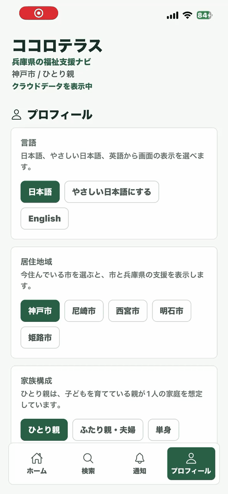
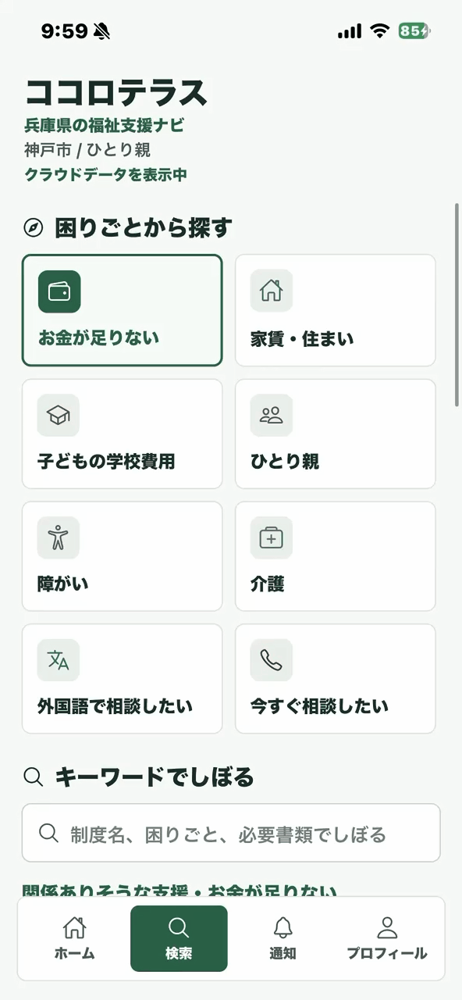
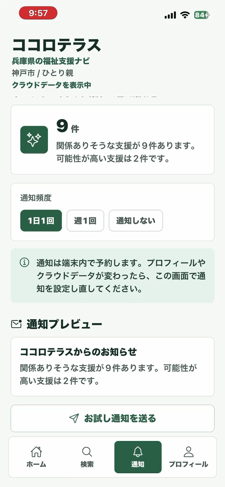
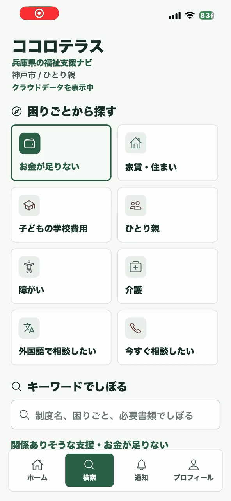
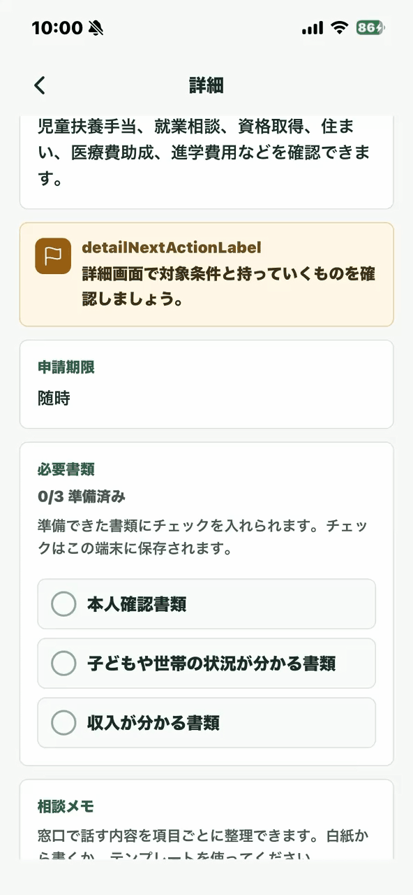

# ココロテラス

ココロテラスは、子育て・ひとり親・障がい・外国人住民・生活相談など、福祉に関係する公的支援を探しやすくするためのスマホアプリです。

忙しくて自治体サイトを細かく確認できない人や、行政情報を読むのが難しい人でも、自分に関係がありそうな支援制度を短時間で確認できることを目指しています。

現在は、兵庫県と神戸市・尼崎市・西宮市・明石市・姫路市の福祉支援情報を扱っています。

## 機能デモ

以下のGIFは、現在実装している主な機能の操作例です。左から、言語機能、保存機能、通知機能、検索機能、メモ機能、公式サイトにアクセスする機能です。

<table>
  <tr>
    <th>言語機能</th>
    <th>保存機能</th>
    <th>通知機能</th>
    <th>検索機能</th>
    <th>メモ機能</th>
    <th>公式サイト</th>
  </tr>
  <tr>
    <td></td>
    <td></td>
    <td></td>
    <td></td>
    <td></td>
    <td></td>
  </tr>
</table>

## このアプリでできること

- 居住地域、家族構成、子どもの人数、障がいの有無、外国人向け支援の必要性、使用言語を登録
- プロフィールを端末内に保存し、変更内容を支援情報へ反映
- 条件に合いそうな福祉支援と、表示された理由を確認
- 「困りごと」やキーワードから支援制度を検索
- 支援制度の対象条件、必要書類、申請方法、公式リンクを確認
- 支援情報を「あとで見る」に保存
- 必要書類の準備状況をチェック
- 窓口で相談したい内容をメモとして作成・保存
- 関係がありそうな支援件数を毎日または毎週通知
- 日本語、やさしい日本語、英語の表示切り替え
- Firebase Firestoreから支援制度データを取得

## 開発の背景

このアプリは、学校の発表用アプリとして開発しています。

シングルマザー、低所得の労働者、介護者、子育て中の保護者、外国人住民など、支援が必要な人ほど行政情報を調べる時間や余裕がないことがあります。もしこのアプリが少しでも世の中のためになる可能性があるなら、まず試作品として作ってみたいと思いました。

## AIを用いた開発について

このアプリのコーディングは、基本的にAIを活用して行っています。

理由は大きく3つあります。

1. 自分だけの実力で作ったものではないことを明確にしたいから
2. 福祉支援を探しやすくするアプリに社会的な意味があると感じたから
3. これからの時代、AIを使ってアプリを開発するケースが増えると考え、その実験として取り組みたかったから

AIには、機能追加、バグ修正、画面設計、データ設計、Firebase連携、README作成などを手伝ってもらっています。  
ただし、アプリの目的、方向性、必要な機能、修正したい内容は自分で考えながら開発しています。

このリポジトリは、「AIを使うことで、個人でも社会課題に向けたアプリをどこまで作れるのか」を試す意味もあります。

## 技術スタック

- React Native
- Expo
- TypeScript
- Firebase
- Cloud Firestore
- Firebase Admin SDK
- AsyncStorage
- Expo Notifications

## データについて

現在は兵庫県内の福祉支援情報を中心に扱っています。

アプリはFirebase Firestoreから支援制度データを取得します。取得に失敗した場合は、アプリ内にあるローカルデータを使って表示します。

実際に利用する場合は、必ず公式サイトの情報を確認してください。このアプリでは「対象となる可能性がある」支援を表示しますが、対象であることを断定するものではありません。

## 起動方法

Firebaseを使うため、まず `.env.example` をコピーして `.env` を作成し、自分のFirebase設定値を入れてください。

```bash
copy .env.example .env
```

`.env` にはAPIキーなどの設定値が入るため、GitHubへ公開しないでください。

```bash
npm install
npm run start
```

PowerShellで `npm` が実行できない場合は、以下を使ってください。

```bash
npm.cmd install --cache C:\cocoterrace\.npm-cache
npm.cmd run start
```

Expo GoでQRコードを読み取ると、iOS / Androidで確認できます。

接続しにくい場合は、tunnel起動を使います。

```bash
npm.cmd run start -- --tunnel --clear
```

## Firestoreへのデータ登録

支援制度データは、以下のコマンドでFirestoreへ一括登録できます。

```bash
npm run firestore:import -- --key=secrets/firebase-service-account.json
```

事前確認だけしたい場合は、dry-runを使います。

```bash
npm run firestore:import:dry
```

サービスアカウント秘密鍵は公開してはいけません。`secrets/firebase-service-account.json` はGit管理に含めないでください。


## 注意点

- このアプリは試作品です
- 表示される支援制度は、公式情報の確認が必要です
- 個人情報やセンシティブな情報の扱いには注意が必要です
- 実運用する場合は、データ更新方法、確認フロー、セキュリティルールの整備が必要です
